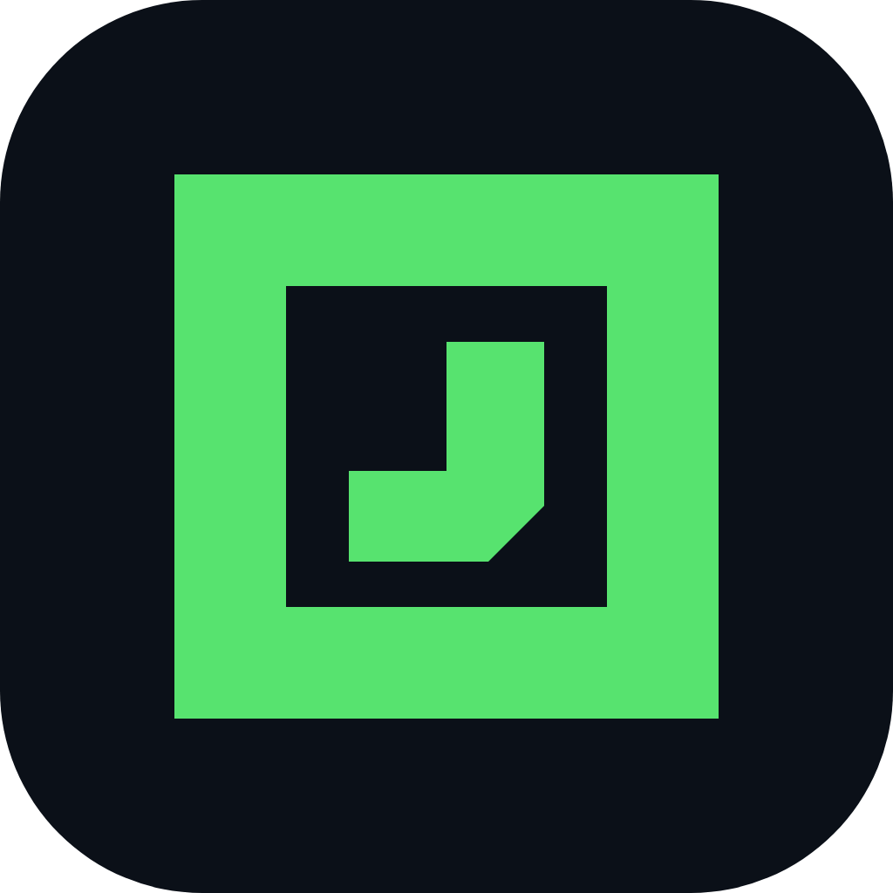
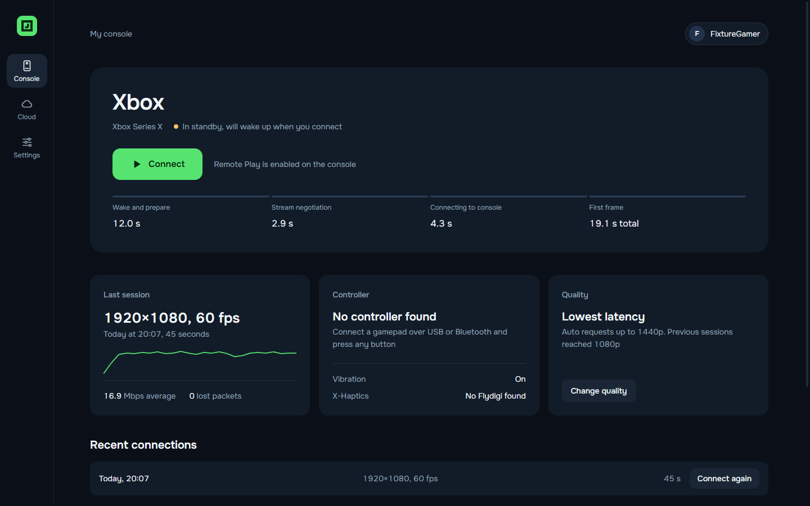
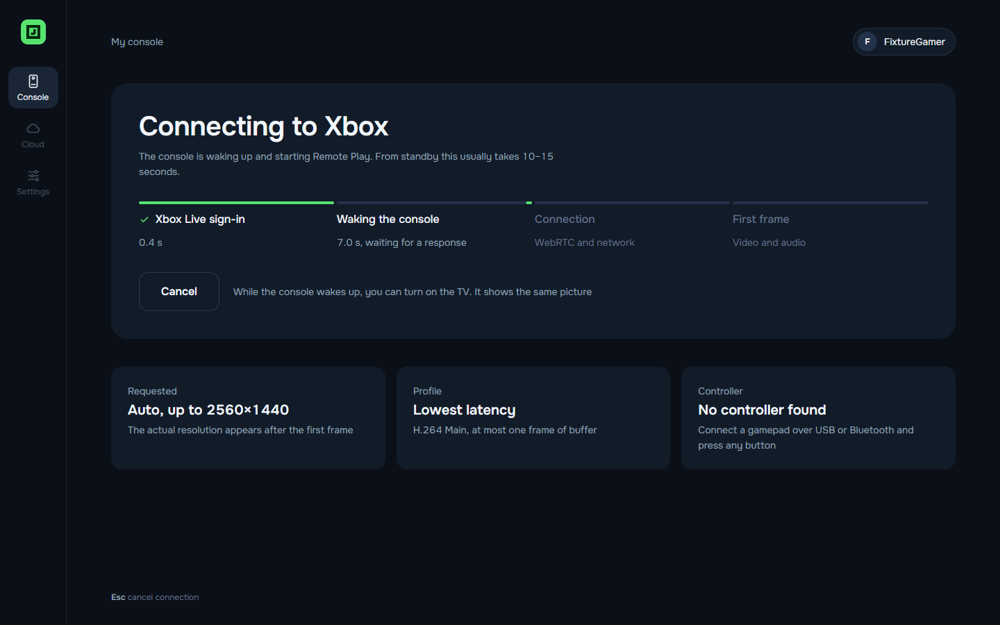
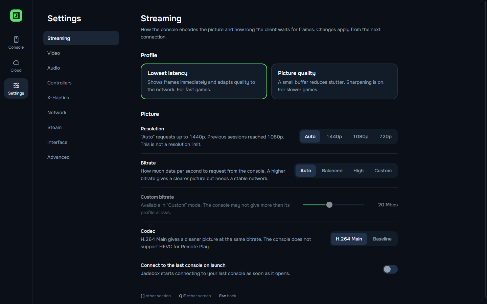
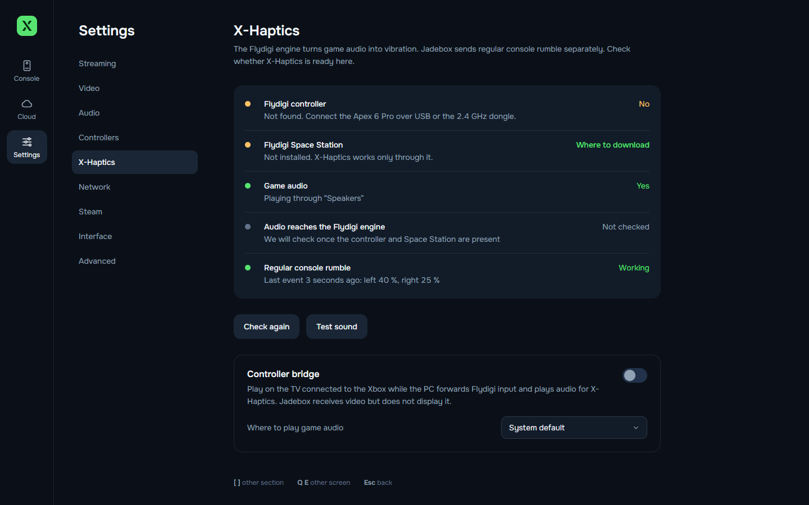
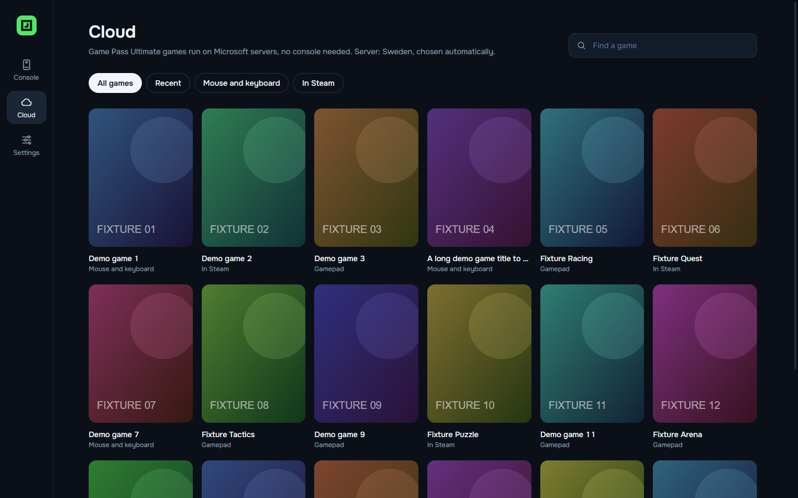
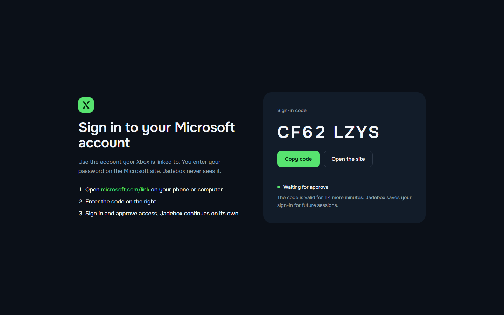
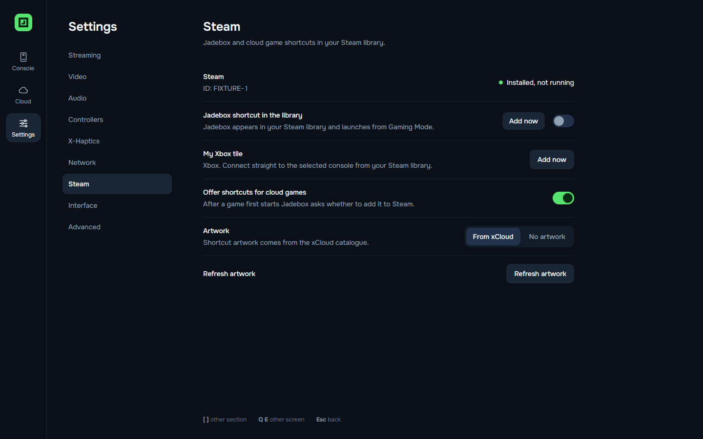
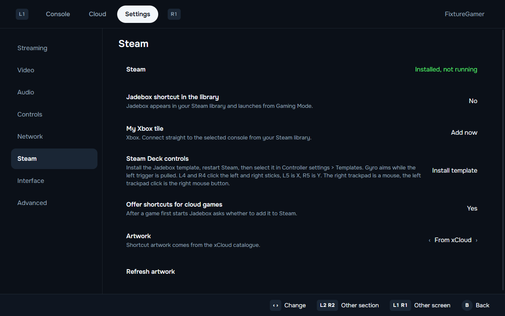

<p align="center">
  
</p>

<h1 align="center">Xenith</h1>

<p align="center">
  An open-source Xbox Remote Play and Xbox Cloud Gaming client for Windows 11 and Steam Deck.<br>
  English and Russian interfaces, gamepad navigation, and measured stream statistics.
</p>

<p align="center">
  <b>English</b> · <a href="README.ru.md">Русский</a>
</p>



## Features

### Play your Xbox on a PC or Steam Deck

Xenith shows your own Xbox on another screen. The game runs on the console, and Xenith receives the picture and sound over the network and sends your controller input back. You can play in another room, on a laptop, or on a Steam Deck while the TV is busy.

Xenith finds the consoles linked to your account, wakes a console from standby, and connects with one button. The stream goes up to 1440p. Pick Auto, 1440p, 1080p, or 720p in the streaming settings.

Remote Play is free. Any Xbox account works, and no Game Pass subscription is needed. You need your own Xbox One or Xbox Series X|S connected to the internet. On the console, turn on Settings > Devices & connections > Remote features and set the power mode to Sleep, otherwise the console cannot wake for a connection. Any game installed on the console can be streamed, including games bought outside Game Pass.

### Cloud games from Game Pass Ultimate

With Game Pass Ultimate you can play without a console. The game runs on Microsoft's servers. Xenith shows the cloud catalogue with search and cover art. When servers are busy, it shows your place in the queue and an estimated wait.

Cloud gaming needs a Game Pass plan that includes it, and it works only in countries where Microsoft offers Xbox Cloud Gaming. It is not officially available in Russia. Check Microsoft's current plans and country list before you subscribe.

### Stream statistics you can trust

The overlay shows what actually arrives: frame resolution, bitrate, network round-trip time, video buffer, decode time, and packet loss. If the console sends 1080p, Xenith shows 1080p even when you asked for 1440p. Use it to see whether lag comes from the network or from your device.

### Profiles and picture controls

Three profiles cover the common cases. "Lowest latency" keeps the video buffer at about 3 ms for fast games. "Picture quality" buffers more to smooth out an unstable network. "Battery saver" is for the Steam Deck.

You can sharpen the picture (CAS), upscale a lower-resolution stream (FSR 1.0), adjust brightness, contrast, and saturation, and choose how the video fits the screen. Every effect can be turned off.

### Smoother picture with Lossless Scaling

Xenith has no built-in frame generation. On Windows you can run Lossless Scaling over the Xenith window to add generated frames. This can turn a 30 fps console game into 60 fps on your screen. Turn on "Drop repeated frames" in Settings > Video for this: the stream repeats every frame of a 30 fps game, and Xenith then shows only the new ones. See [Frame generation with Lossless Scaling](#frame-generation-with-lossless-scaling) for the settings and limits. Lossless Scaling over Xenith has not been tested on real hardware yet.

### Gamepad first

The whole app works with a gamepad, no mouse needed. During a game, tap View + Menu together to press the Xbox button, or hold them to open the Xenith menu. You can set stick dead zones, rumble, and trigger rumble. Mouse and keyboard work in cloud games that support them.

### Steam and Steam Deck

Xenith adds itself, your console, and individual cloud games to your Steam library with artwork. On the Deck it ships a controller template with gyro aiming and back buttons, switches the screen to 60 Hz while streaming, and reconnects after the Deck wakes from sleep. See [Steam Deck integration](#steam-deck-integration).

### Controller bridge for Flydigi X-Haptics

Some Flydigi controllers (for example the Apex series) have X-Haptics. Flydigi Space Station listens to game sound and turns it into vibration: you feel explosions, engines, and gunfire. This only works on a PC, because Space Station runs on Windows. An Xbox cannot run it.

Controller bridge mode solves this. You play on the TV connected to the Xbox, as usual. The controller connects to the PC. Xenith forwards your input from the PC to the console, receives the game sound, and plays it so Space Station can turn it into vibration. Xenith hides the video on the PC, because you watch the TV. The TV picture comes straight from the Xbox over HDMI, with no streaming delay or compression.

Turn it on in Settings > X-Haptics > Controller bridge. While it is on, the PC screen shows a note with a "Show video" button, so a black window is not mistaken for a fault. The same settings page checks the controller, Space Station, and the game audio. Hiding the video cut PC GPU load from about 1% to almost zero in a hardware test. The project owner checked the setup with a physical Flydigi controller on November 13, 2026 and reported that it works. That check has no recorded measurements.

### Reconnection and privacy

If the connection drops, Xenith starts a new session on its own. In a hardware test the picture came back in about nine seconds. You sign in on Microsoft's website, so Xenith never sees your password. Tokens stay in the operating system's secure storage and are never written to logs.

## Screenshots

New installations use English. Select a language in Settings > Interface > Language. Existing installations keep their saved choice. All screenshots on this page show the English interface.

| Connecting | In-game menu |
|---|---|
|  |  |

| Streaming settings | X-Haptics |
|---|---|
|  |  |

| Cloud games | Sign in with a code |
|---|---|
|  |  |

| Steam Deck home | Steam Deck in-game menu |
|---|---|
|  |  |

| Steam integration | Steam integration on Deck |
|---|---|
|  |  |

Screenshots use demo data and placeholder game covers. Interface mockups are in [docs/design](docs/design).

## Installation

### Windows 11

1. Download `Xenith-Setup-<version>.exe` from [Releases](https://github.com/kirtarget/xenith/releases). A portable `Xenith-<version>-win-x64.zip` is also published.
2. Run the installer. It installs for the current user without administrator rights.
3. The builds are unsigned. If Windows SmartScreen blocks the installer, select "More info", then "Run anyway".

### Steam Deck and SteamOS

Xenith has a native Linux build. See the [Steam Deck notes](docs/platform/steam-deck.md) for setup details and troubleshooting.

1. In Desktop Mode, download `Xenith-<version>-linux-x86_64.AppImage` and allow it to run as a program in its file properties.
2. Add it to Steam with "Add a Non-Steam Game" or the "Add now" button in Xenith's Steam settings. Leave Proton disabled for the shortcut.
3. Keep Steam Input enabled with the "Gamepad" template so the Deck controls appear as an Xbox controller.

The launcher reached the sign-in screen on a Steam Deck OLED. A later fix for an endless Gaming Mode loading screen still needs a hardware retest. Streaming and VA-API performance on the Deck have not been measured.

### macOS

The build configuration and GitHub Actions workflow publish DMG and ZIP packages for Apple Silicon only. There is no Intel Mac build. The builds are unsigned and have not been tested on a real Mac.

### Updates

At start-up Xenith checks GitHub Releases for a newer version. How it updates depends on how it was installed:

| Installed from | What happens |
|---|---|
| Windows installer (`Xenith-Setup-<version>.exe`) | The update downloads in the background. The home screen then shows "Restart and update". If you just quit, it installs on exit. |
| AppImage (Steam Deck, Linux) | The update downloads in the background and installs only when you select "Restart and update". The new file replaces the old one in the same folder, and the Steam shortcut is pointed at it on the next start. |
| Portable zip, tar.gz, macOS | Xenith shows a card with a Download button that opens the Releases page. Install the new build yourself. |

Settings and sign-in are kept. Pre-releases and draft releases are ignored. Without a network connection the check fails silently. Set `XENITH_NO_AUTOUPDATE=1` to turn off automatic downloads. Automatic installation has been checked with automated packaging only, not yet across two real releases.

## First run

1. Select "Sign in". Open [microsoft.com/link](https://www.microsoft.com/link) on your phone or computer, enter the code shown by Xenith, and sign in with the account linked to your Xbox. Enter your password only on Microsoft's website. Xenith does not receive it.
2. On the Xbox, enable Settings > Devices & connections > Remote features.
3. Select "Connect".

Tokens use the operating system's secure storage on Windows and macOS. SteamOS and Linux without a working keyring use encrypted local files with a key protected by file permissions. See [secure-store.ts](src/main/secure-store.ts) for the storage implementation.

## Controls while streaming

| Action | Gamepad | Keyboard and mouse |
|---|---|---|
| Open the Xenith menu | Hold View + Menu for about 0.6 seconds | Esc or F1, or select "Menu" after moving the mouse |
| Press the Xbox button | Tap View + Menu together | F2 or "Press the Xbox button" in the menu |
| Toggle full screen | Use the session menu | F11 or F10 |
| Disconnect | Select "Disconnect" in the menu | Select "Disconnect" in the menu |

## Frame generation with Lossless Scaling

[Lossless Scaling](https://store.steampowered.com/app/993090/Lossless_Scaling/) is a paid Windows app on Steam. Its LSFG frame generation draws extra frames between the ones it captures from a window. Many console games run at 30 fps. With LSFG x2 over Xenith you would see 60 fps on the PC screen.

This setup has not been tested with Xenith yet. The steps below follow how Lossless Scaling works with any window. Treat the result as unverified until the test log has numbers.

### What it costs

- Latency. LSFG holds back about one source frame to draw the frame in between. At 30 fps that is about 33 ms on top of the stream's own delay. It is fine for driving and walking around, and you will feel it in fast shooting.
- Artifacts. Generated frames can smear around the HUD, subtitles, and fast-moving edges.
- GPU load on the PC. Frame generation runs on your graphics card, not on the console.

### Settings in Xenith

1. Settings > Streaming: pick the "Lowest latency" profile. A longer video buffer adds to LSFG's own delay.
2. Settings > Video: set Sharpness (CAS) to 0 and turn FSR upscaling off. Lossless Scaling then works on the clean picture and does not process it twice.
3. Keep "Picture size" on "Fit".
4. Settings > Video: turn on "Drop repeated frames". See below for why.

### Settings in Lossless Scaling

1. Scaling type: Off. You only want frame generation.
2. Frame generation: LSFG 3.1.
3. Mode: Fixed, multiplier 2. Fixed x2 turns 30 fps into 60.
4. Capture API: WGC. If the picture does not appear, try DXGI.
5. Sync mode: Default. Choose "Off (Allow tearing)" for lower latency if your monitor has VRR (FreeSync or G-Sync).
6. Max frame latency: 1.
7. Turn on "Draw FPS" for the first run, so you can see that generation works.

### Start it

1. Start a game in Xenith and switch to full screen with F11.
2. Press Ctrl+Alt+S, the default Lossless Scaling hotkey, while the Xenith window is in front. Or click "Scale" in Lossless Scaling and switch to Xenith within the delay.
3. Press the hotkey again to stop.

### Why drop repeated frames

The Xbox stream runs at 60 fps even when the game itself runs at 30. Every game frame then reaches the PC twice. Without the filter, LSFG sees pairs of identical frames, has nothing to draw between them, and the motion stays at 30 fps.

With "Drop repeated frames" on, Xenith compares each new frame with the last one it showed and draws it only when the picture changed. The window then updates about 30 times a second with real game frames, and LSFG x2 fills the gaps up to 60. A 60 fps game is not affected: every frame differs, so every frame is drawn.

- It works only when sharpness is 0 and FSR is off. With either of them on, Xenith uses that picture path instead.
- A frame counts as new when some 30 x 30 pixel area of a 1080p picture changed by more than a small threshold. Xenith always draws at least every fourth frame, so very slow changes still reach the screen.
- The log records a `stream.post.dedupe` line every 5 seconds with frames received, drawn, and skipped. On a 30 fps game about half the frames should be skipped.

A synthetic check passed. A 30-in-60 test source made the window repaint 31 times a second instead of 62, and a 60 fps source with an 8-pixel object moving 2 pixels a frame still repainted 62 times a second. The filter has not run on a real Xbox stream yet. Compression noise on real repeated frames may be higher than in the test. Check the `stream.post.dedupe` numbers with a 30 fps game such as Red Dead Redemption 2 or GTA V in Fidelity mode.

## Launch arguments

| Argument | Effect |
|---|---|
| `--xhome` | Connect to the last used console, or the first available console |
| `--xhome=<serverId>` | Connect to a specific console |
| `--xcloud=<titleId>` | Start a cloud game, as used by cloud game shortcuts in Steam |

## Steam Deck integration

### My Xbox tile

Sign in and select a console on the home screen. Open Settings > Steam and select "Add now" beside "My Xbox tile". Restart Steam to see the tile. It connects directly to that console with `--xhome=<serverId>`. You can add a separate tile for each console. Adding the same console again updates its existing shortcut.

### Gyro and back buttons

In Settings > Steam, select "Install template" beside "Steam Deck controls". Restart Steam. Open the controller settings for the Xenith or Xbox shortcut, select the current layout, open Templates, and apply "Xenith - Gyro and back buttons". Installation adds a template without replacing your selected layout.

| Control | Action |
|---|---|
| Gyro while the left trigger is pulled | Aim using the right stick |
| L4 / R4 | Left / right stick click |
| L5 / R5 | Xbox X / Y |
| Right trackpad | Mouse; click is the left mouse button |
| Left trackpad click | Right mouse button |

The Xenith menu stays on View + Menu (hold) and the Xbox button on View + Menu (short press).

Adjust gyro sensitivity and activation in Steam Input. The gyro emulates a stick, so the game's stick sensitivity and dead zone affect aiming. Separate cloud game shortcuts can use separate Steam layouts. Remote Play does not automatically identify the game running on the console.

### Trackpad mouse in cloud games

With the Xenith template, the right trackpad moves the mouse and clicks the left button; clicking the left trackpad is the right button. On the Deck, Xenith forwards mouse input automatically in cloud games that support mouse and keyboard, even if "Mouse and keyboard" is off in settings. Console Remote Play does not accept mouse input.

### 60 Hz screen while streaming

The stream is 60 fps. In Gaming Mode Xenith sets the screen to 60 Hz for the session (gamescope `GAMESCOPE_DYNAMIC_REFRESH`, the value Steam's refresh-rate slider uses) and restores the previous rate afterwards. On the Deck OLED this removes the judder of 60 fps on a 90 Hz panel and saves battery. Turn it off in Settings > Streaming > "Screen at 60 Hz while streaming".

### Sleep and reconnect

When the Deck sleeps during a session, Xenith remembers the console or cloud title and stops local streaming. After waking, it waits for network connectivity and attempts to reconnect to the same target. Disconnecting or signing out cancels pending recovery.

Sleeping the Deck does not guarantee that the remote game pauses. A cloud session may expire, and reconnecting may start a new session or queue.

### Search keyboard

In Gaming Mode, focusing the cloud search field or pressing Y requests Steam's on-screen keyboard. If it does not appear, press Steam + X. This integration applies to Xenith's search field; it does not automatically detect text fields inside a streamed game.

### Picture size on the Deck screen

Xbox video uses 16:9, while the Deck screen is 16:10. Open the Xenith menu during streaming and change "Picture size" with left/right or A. Changes apply immediately, including with CAS sharpening or FSR upscaling.

| Mode | Result on a 1280 x 800 Deck screen |
|---|---|
| Fit | Keeps the whole frame and its proportions, with 40-pixel bars above and below a 16:9 stream |
| Fill | Fills the screen and crops about 5% from each side; game interface elements near the edges may be lost |
| Stretch | Fills the screen without cropping by stretching the picture vertically by about 11% |

Fit is the default. Xenith remembers the selected mode separately for each cloud game and restores it on the next connection. Other games keep their own choices. For Remote Play, this control changes the global picture setting. These modes do not change the stream resolution or create a wider field of view.

The shortcut and recovery logic have automated checks. Template selection, gyro feel, trackpad mouse, the 60 Hz switch, keyboard visibility, and recovery after actual Deck sleep still need verification on hardware.

## Hardware measurements

These measurements used an Xbox Series X on a local network and a PC with a Radeon RX 9070 XT on October 22, 2026. They describe that setup. See the [test log](docs/TESTLOG.md) for methods and remaining checks.

| Metric | Recorded value |
|---|---|
| Resolution and frame rate | 1920 x 1080 at 60 fps |
| Codec | H.264 Main 4.2 |
| Bitrate | About 16 to 18 Mbps |
| Decode time | 0.3 to 0.4 ms per frame; hardware decoding inferred from GPU activity |
| Video buffer | About 2.6 to 2.8 ms with "Lowest latency", about 23 ms with "Picture quality" |
| Connection to first frame | About 7 to 10 seconds with the console on, about 19 seconds from standby |
| Reconnection after a drop | About nine seconds |
| 594-second sample | No packet loss or dropped frames; stable memory usage |

A keepalive issue ended the 594-second run. The fix passed a shorter integrated session, but the full ten-minute test has not been repeated.

## Known limitations

- Xenith supports 1440p streaming. The hardware measurements above used a 1080p stream and do not describe the app's maximum resolution. Stream statistics show the resolution actually received.
- The tested console ignored requests for bitrates above about 18 Mbps. Lower bitrate limits worked.
- Cloud traffic routed through a VPN may connect without video. Excluding Xenith or the Xbox Cloud servers from the tunnel may help.
- X-Haptics does not need a Flydigi audio device, and the controller does not provide one. Add `Xenith.exe` as a game in Space Station's X-Haptics and keep any output device, headphones included. Space Station captures Xenith's audio directly. The "Game audio" check reads that Space Station game list. A development run (`electron.exe`) does not match a profile made for the installed app.
- Steam Deck Gaming Mode and macOS require the follow-up checks described above.
- If the GPU process restarts mid-stream (driver reset or crash), the sharpening canvas loses its WebGL context. Xenith now drops it and rebuilds it, so the picture returns within a fraction of a second. This was checked by killing the GPU process during a Remote Play session on Windows. Before this fix the screen stayed black until the app restarted.
- The log in `%APPDATA%\Xenith\logs` records GPU and renderer process crashes (`process.gone`, `renderer.gone`), GPU info at start-up (`gpu.info`, `gpu.feature_status`), picture post-processing changes (`stream.post.*`, including `stream.post.dedupe` counts for the repeated-frame filter), and a picture sample every 5 seconds when something changes (`stream.picture`). `stream.black_video` means the console itself sent a black picture for 15 seconds. A normal `stream.picture` brightness while the screen looks black points to the display path, not the stream. Connection and controller events are logged too: WebRTC state (`stream.pc.state`), stream state (`stream.state`), the cause of a lost stream (`stream.loss`, for example `disconnected` or `main:...`), each automatic re-session (`stream.resession*`; the old session then ends with reason `replaced`), the controller list (`stream.controllers`) and the pad Xenith sends to the console (`stream.pad.active`, `null` when none).

## Build from source

Install Node.js 22 or later and Git. The CI workflow uses Node.js 24.

```bash
npm ci
npm run typecheck
npm run build
npx electron .
```

Create a Windows installer and portable ZIP after building the app.

```bash
npx electron-builder --win nsis zip --publish never
```

The [CI workflow](.github/workflows/build.yml) also defines Linux and macOS builds. Packaging requires a suitable host for the target operating system.

Run the automated checks.

```bash
node tools/core-test/run.mjs
node tools/platform-test/run-tests.mjs
node tools/stream-test/run-input-test.mjs
```

On a desktop session, verify Steam shortcut files, artwork, and template installation in an isolated temporary Steam directory. This does not modify your Steam library.

```bash
node tools/platform-test/run-steam-smoke.mjs
```

Check live Fit/Fill/Stretch changes with the real FSR WebGL pipeline and a generated local video source.

```bash
node tools/ui-preview/check-fsr.mjs
```

Check the repeated-frame filter. A synthetic 60 fps source runs with and without repeats, and the check counts real window repaints.

```bash
node tools/ui-preview/check-dedupe.mjs
```

Preview and check the English interface on desktop and Steam Deck layouts with fixture data.

```bash
node tools/ui-preview/build.mjs
npx electron tools/ui-preview/capture.cjs --lang=en --check --sizes=1440x900,deck
```

## Architecture

Xenith uses Electron, Chromium WebRTC, and React. See the [stack decision](docs/adr/0001-stack-electron.md) for the reasoning.

| Directory | Responsibility |
|---|---|
| `src/main` | Microsoft and Xbox Live sign-in, Remote Play and cloud session APIs, game catalogue, settings, history, and logs |
| `src/main/platform` | GPU configuration, VA-API, Steam Deck detection, Steam shortcuts, and Flydigi diagnostics |
| `src/renderer` | React interface, gamepad navigation, and English and Russian translations |
| `src/renderer/stream` | WebRTC streaming, statistics, profiles, picture processing, input, and reconnection |
| `src/shared` | Shared types and contracts |

## Contributing

Project changes must include matching README updates. Keep [AGENTS.md](AGENTS.md) and [CLAUDE.md](CLAUDE.md) identical. CI checks their contents with `node tools/check-agent-docs.mjs`.

## Credits and licence

Xenith uses the [MIT licence](LICENSE). Its protocol implementation draws on these MIT-licensed projects.

- [Greenlight](https://github.com/unknownskl/greenlight) and [xbox-xcloud-player](https://github.com/unknownskl/xbox-xcloud-player) by unknownskl.
- [XStreaming-desktop](https://github.com/Geocld/XStreaming-desktop) and [xstreaming-player](https://github.com/Geocld/XStreaming-player) by Geocld. The player is included in `vendor/` with local fixes.
- [better-xcloud](https://github.com/redphx/better-xcloud) by redphx.

Xenith is not affiliated with Microsoft or Xbox. Xbox is a trademark of Microsoft.
