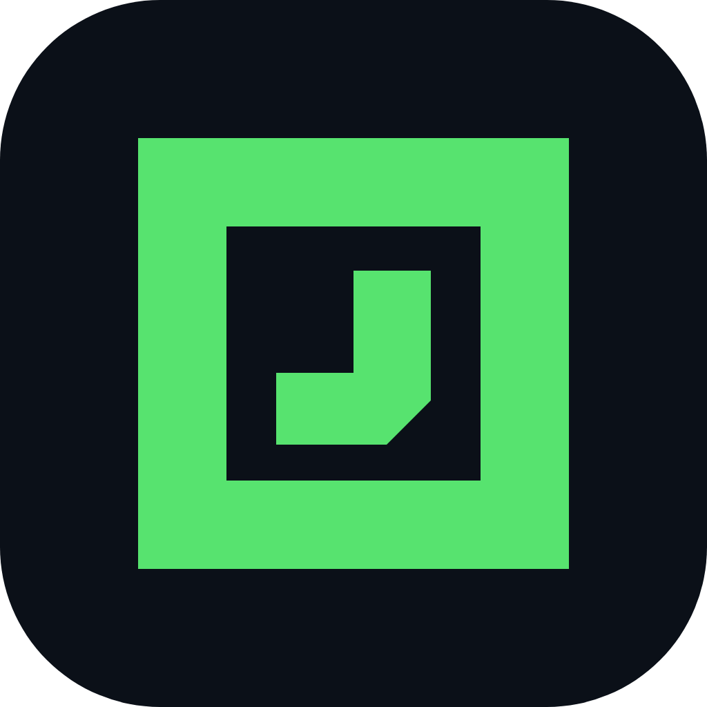
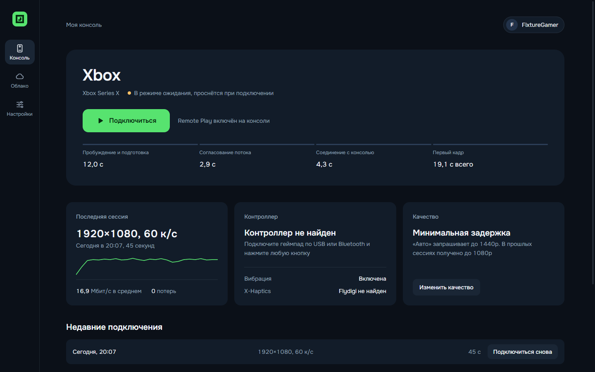
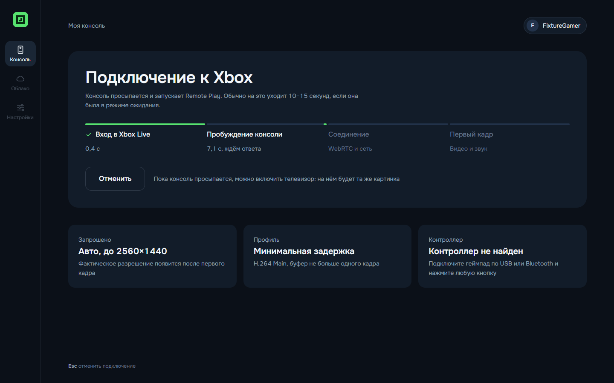
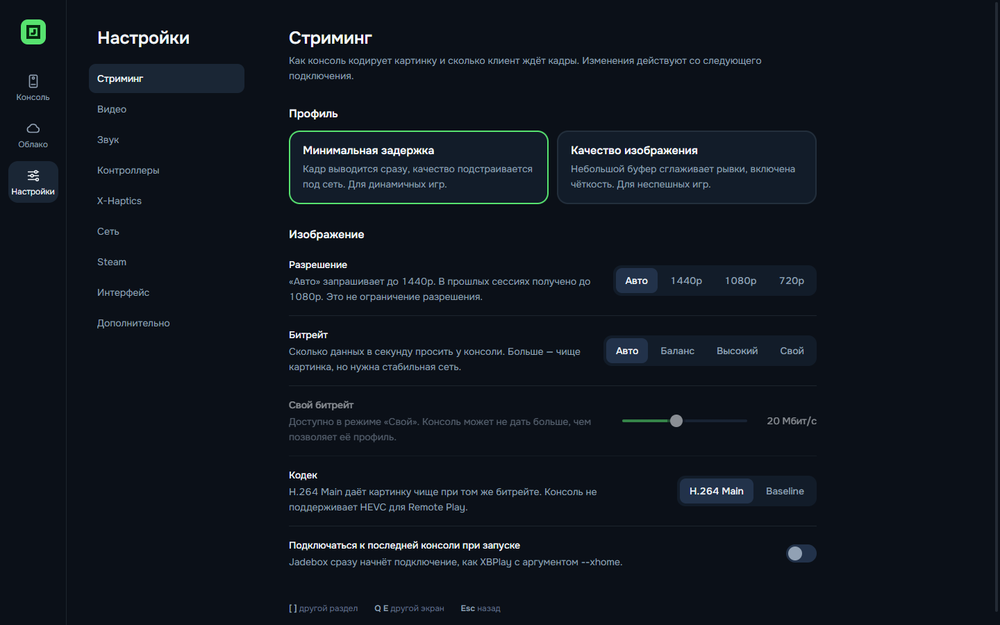
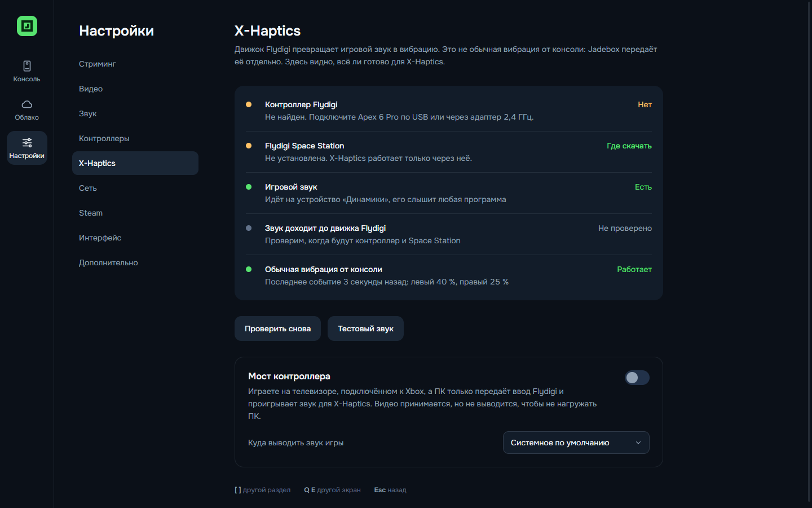
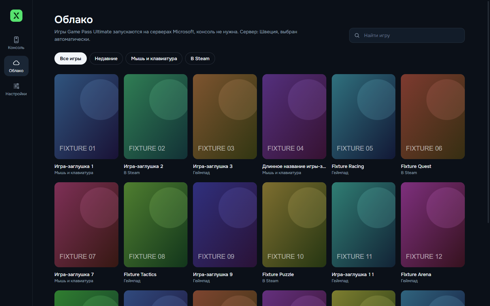
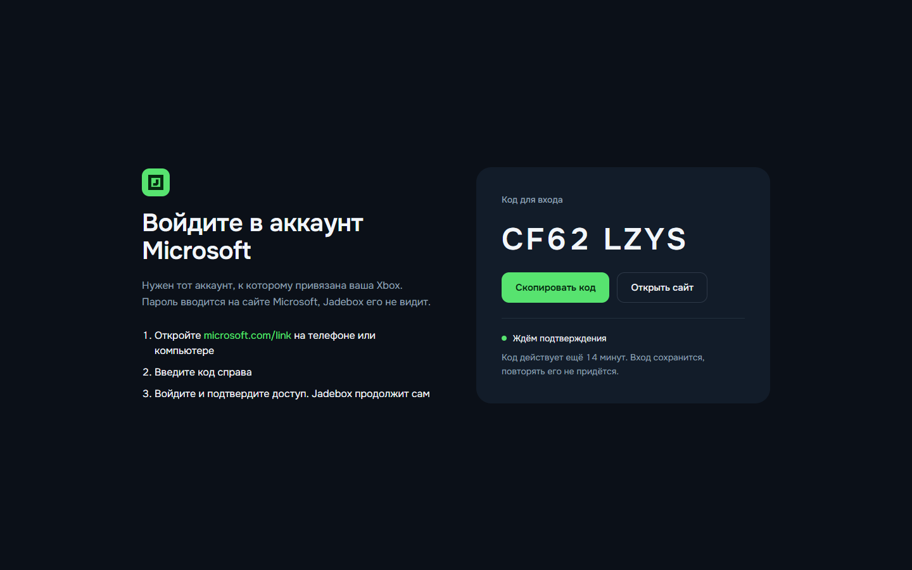
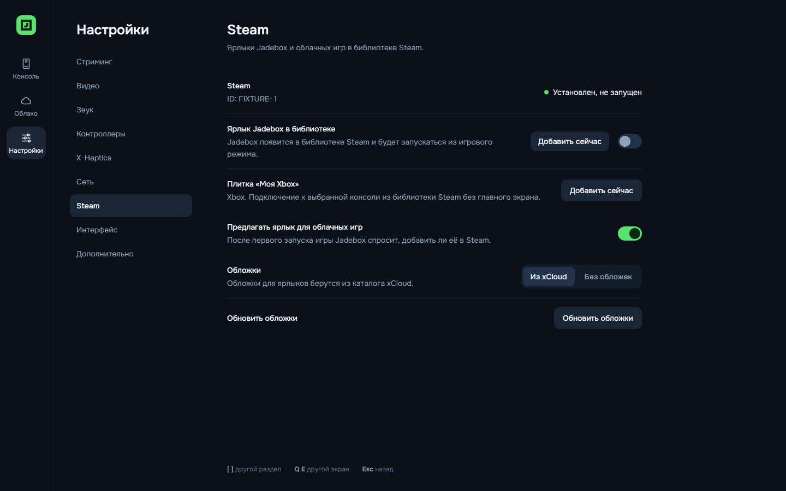
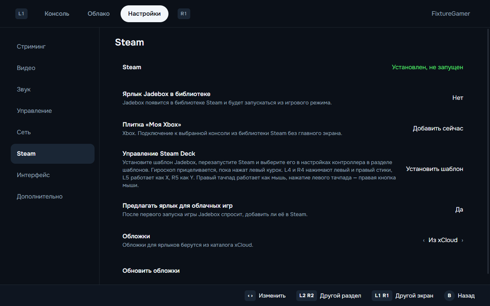

<p align="center">
  
</p>

<h1 align="center">Xenith</h1>

<p align="center">
  Открытый клиент Xbox Remote Play и Xbox Cloud Gaming для Windows 11 и Steam Deck.<br>
  Русский и английский интерфейс, управление геймпадом, честная статистика потока.
</p>

<p align="center">
  <b>Русский</b> · <a href="README.md">English</a>
</p>



## Что умеет

### Своя Xbox на ПК или Steam Deck

Xenith выводит вашу Xbox на другой экран. Игра работает на консоли, а Xenith получает по сети картинку и звук и отправляет обратно нажатия геймпада. Можно играть в другой комнате, на ноутбуке или на Steam Deck, пока телевизор занят.

Xenith сам находит консоли в аккаунте, будит консоль из режима ожидания и подключается одной кнопкой. Стрим идёт в разрешении до 1440p. В настройках стриминга можно выбрать Auto, 1440p, 1080p или 720p.

### Облачные игры Game Pass Ultimate

С подпиской Game Pass Ultimate консоль не нужна: игра запускается на серверах Microsoft. Xenith показывает облачный каталог с поиском, русскими названиями и обложками. Если серверы заняты, видно место в очереди и примерное время ожидания.

### Честные цифры стрима

Счётчик показывает то, что реально приходит: разрешение кадра, битрейт, задержку сети, буфер видео, время декодирования и потери пакетов. Если консоль отдаёт 1080p, Xenith покажет 1080p, даже если вы просили 1440p. По этим цифрам видно, откуда лаг: из сети или из вашего устройства.

### Профили и картинка

Три профиля под типичные случаи. «Минимальная задержка» держит буфер видео около 3 мс, это для быстрых игр. «Качество изображения» копит буфер побольше и сглаживает нестабильную сеть. «Экономия батареи» нужен для Steam Deck.

Картинку можно сделать чётче (CAS), растянуть стрим низкого разрешения с масштабированием FSR 1.0, подправить яркость, контраст и насыщенность и выбрать, как видео заполняет экран. Любой эффект отключается.

### Плавнее с Lossless Scaling

Встроенной генерации кадров в Xenith нет. На Windows поверх окна Xenith можно запустить Lossless Scaling, и он дорисует промежуточные кадры. Так консольная игра в 30 fps может выглядеть на экране как 60 fps. Настройки и ограничения описаны в разделе [Генерация кадров через Lossless Scaling](#генерация-кадров-через-lossless-scaling). С Xenith эта связка пока не проверялась.

### Всё с геймпада

Всё приложение управляется геймпадом, мышь не нужна. Во время игры короткое нажатие View + Menu работает как кнопка Xbox, а удержание открывает меню Xenith. Настраиваются мёртвые зоны стиков, вибрация и вибрация курков. В облачных играх с поддержкой мыши и клавиатуры работают и они.

### Steam и Steam Deck

Xenith добавляет в библиотеку Steam себя, вашу консоль и отдельные облачные игры с обложками. Для Deck есть шаблон управления с гироприцеливанием и задними кнопками. На время стрима экран переключается на 60 Гц, а после выхода Deck из сна Xenith сам переподключается. Подробности в разделе [Интеграция со Steam Deck](#интеграция-со-steam-deck).

### Мост контроллера для Flydigi X-Haptics

У некоторых контроллеров Flydigi (например, серии Apex) есть X-Haptics. Программа Flydigi Space Station слушает звук игры и превращает его в вибрацию: вы чувствуете взрывы, мотор и выстрелы. Работает это только на ПК, потому что Space Station есть только под Windows. На Xbox её не запустить.

Режим «Мост контроллера» это обходит. Вы играете на телевизоре, подключённом к Xbox, как обычно. Контроллер подключён к ПК. Xenith передаёт нажатия с ПК на консоль, получает звук игры и проигрывает его, чтобы Space Station превратила его в вибрацию. Видео на ПК Xenith прячет: вы же смотрите в телевизор. Картинка на телевизоре идёт с Xbox напрямую по HDMI, без задержки стрима и без сжатия.

Включается в Настройках, раздел X-Haptics, пункт «Мост контроллера». Пока режим включён, на экране ПК висит подсказка с кнопкой «Показать видео», чтобы чёрное окно не принимали за сбой. В том же разделе можно проверить контроллер, Space Station и игровой звук. В тесте на железе скрытое видео снизило нагрузку на видеокарту ПК примерно с 1% почти до нуля. Полную связку с настоящим контроллером Flydigi ещё нужно проверить.

### Переподключение и безопасность

Если связь оборвалась, Xenith сам заводит новую сессию. В тесте на железе картинка вернулась примерно через девять секунд. Вход идёт на сайте Microsoft, поэтому пароль Xenith не видит. Токены лежат в защищённом хранилище ОС и не попадают в логи.

## Скриншоты

| Подключение | Во время игры |
|---|---|
|  |  |

| Настройки стриминга | X-Haptics |
|---|---|
|  |  |

| Облако | Вход по коду |
|---|---|
|  |  |

**Steam Deck**

| Главный экран | Меню во время игры |
|---|---|
|  |  |

| Интеграция со Steam | Интеграция со Steam на Deck |
|---|---|
|  |  |

Скриншоты сделаны на демонстрационных данных, поэтому вместо обложек игр — заглушки. Макеты интерфейса лежат в [docs/design](docs/design).

## Установка

### Windows 11

1. Скачайте `Xenith-Setup-<версия>.exe` со страницы [Releases](../../releases) (или портативный `Xenith-<версия>-win-x64.zip`).
2. Запустите установщик. Права администратора не нужны, приложение ставится для текущего пользователя.
3. Сборка пока не подписана, поэтому Windows SmartScreen один раз спросит: «Подробнее» → «Выполнить в любом случае».

### Steam Deck (SteamOS)

Нативная Linux-сборка, без Proton. Подробно: [docs/platform/steam-deck.md](docs/platform/steam-deck.md).

1. В режиме рабочего стола скачайте `Xenith-<версия>-linux-x86_64.AppImage`, в свойствах файла разрешите запуск.
2. Добавьте его в Steam: «Добавить стороннюю игру» или кнопкой «Добавить в Steam» в настройках Xenith. Proton для ярлыка не включайте.
3. Steam Input оставьте включённым с шаблоном «Геймпад»: тогда кнопки Deck видны как обычный Xbox-контроллер.

### macOS

Конфигурация сборки есть (dmg и zip только для Apple Silicon, сборки для Intel Mac нет), собирается в GitHub Actions. Сборка не подписана и пока не проверялась на реальном Mac.

### Обновления

При запуске Xenith спрашивает у GitHub (`api.github.com`), какой релиз последний. Если вышла новая версия, на главном экране появляется карточка с кнопкой «Скачать», которая открывает страницу Releases. Сам Xenith ничего не скачивает и не устанавливает: новую сборку нужно поставить поверх текущей. Настройки и вход сохраняются. Предварительные версии не учитываются. Без сети проверка молча пропускается.

## Первый запуск

1. Нажмите «Войти». Откройте [microsoft.com/link](https://www.microsoft.com/link) на телефоне или компьютере, введите код из Xenith и войдите в аккаунт, к которому привязана Xbox. Пароль вводится на сайте Microsoft, Xenith его не видит.
2. На Xbox включите удалённые функции: «Настройки» → «Устройства и подключения» → «Удалённые функции».
3. Нажмите «Подключиться».

## Управление во время игры

| Действие | Геймпад | Клавиатура и мышь |
|---|---|---|
| Меню Xenith | Удерживать View + Menu ~0,6 с | Esc или F1, кнопка «Меню» в углу при движении мыши |
| Кнопка Xbox | Коротко нажать View + Menu | F2 или «Нажать кнопку Xbox» в меню |
| Полный экран | — | F11 или F10 |
| Отключиться | Меню → «Отключиться» | Меню → «Отключиться» |

## Генерация кадров через Lossless Scaling

[Lossless Scaling](https://store.steampowered.com/app/993090/Lossless_Scaling/) это платное приложение для Windows в Steam. Его генерация кадров LSFG дорисовывает дополнительные кадры между теми, что захватывает из окна. Многие консольные игры идут в 30 fps. С LSFG x2 поверх Xenith на экране ПК было бы 60 fps.

С Xenith эта связка пока не проверялась. Шаги ниже описывают, как Lossless Scaling работает с любым окном. Пока в журнале тестов нет цифр, результат не подтверждён.

### Чем платите

- Задержкой. Чтобы нарисовать промежуточный кадр, LSFG придерживает примерно один исходный кадр. При 30 fps это около 33 мс сверх задержки стрима. Для езды и прогулок терпимо, в быстрой стрельбе почувствуете.
- Артефактами. Дорисованные кадры могут смазываться вокруг интерфейса, субтитров и быстро движущихся краёв.
- Нагрузкой на ПК. Генерация кадров считается на вашей видеокарте, а не на консоли.

### Настройки в Xenith

1. Настройки, раздел «Стриминг»: профиль «Минимальная задержка». Длинный буфер видео добавится к задержке LSFG.
2. Раздел «Видео»: «Чёткость» (CAS) на 0, «Масштабирование FSR» выключить. Тогда Lossless Scaling работает с чистой картинкой и не обрабатывает её второй раз.
3. «Размер картинки» оставьте «Целиком».

### Настройки в Lossless Scaling

1. Scaling type: Off. Нужна только генерация кадров.
2. Frame generation: LSFG 3.1.
3. Mode: Fixed, множитель 2. Fixed x2 превращает 30 fps в 60.
4. Capture API: WGC. Если картинка не появилась, попробуйте DXGI.
5. Sync mode: Default. Если у монитора есть VRR (FreeSync или G-Sync), для меньшей задержки выберите «Off (Allow tearing)».
6. Max frame latency: 1.
7. На первый запуск включите «Draw FPS», чтобы видеть, что генерация работает.

### Запуск

1. Запустите игру в Xenith и разверните на весь экран клавишей F11.
2. Нажмите Ctrl+Alt+S (горячая клавиша Lossless Scaling по умолчанию), пока окно Xenith впереди. Или нажмите «Scale» в Lossless Scaling и переключитесь на Xenith, пока идёт отсчёт.
3. Повторное нажатие горячей клавиши выключает генерацию.

### Открытый вопрос: игра в 30 fps внутри стрима в 60 fps

Стрим с Xbox идёт в 60 fps, даже если сама игра работает в 30. Тогда каждый кадр игры приходит на ПК дважды. LSFG может увидеть повторы, ничего нового между ними не нарисовать, и движение останется на 30 fps. Это первое, что нужно проверить на железе с игрой в 30 fps, например Red Dead Redemption 2 или GTA V в режиме Fidelity.

## Аргументы запуска

| Аргумент | Что делает |
|---|---|
| `--xhome` | Сразу подключиться к последней консоли |
| `--xhome=<serverId>` | Подключиться к конкретной консоли |
| `--xcloud=<titleId>` | Сразу запустить облачную игру (так работают ярлыки облачных игр в Steam) |

## Интеграция со Steam Deck

### Плитка «Моя Xbox»

Войдите в аккаунт и выберите консоль на главном экране. Откройте «Настройки» > Steam и нажмите «Добавить сейчас» рядом с плиткой «Моя Xbox». Перезапустите Steam. Плитка подключается прямо к выбранной консоли через `--xhome=<serverId>`. Для каждой консоли можно добавить отдельную плитку. Повторное добавление обновляет существующий ярлык.

### Гироскоп и задние кнопки

В «Настройки» > Steam нажмите «Установить шаблон» в строке «Управление Steam Deck». Перезапустите Steam. Откройте настройки контроллера ярлыка Xenith или Xbox, выберите текущую раскладку и в разделе шаблонов примените «Xenith - Gyro and back buttons». Установка шаблона не заменяет выбранную раскладку.

| Управление | Действие |
|---|---|
| Гироскоп, пока нажат левый курок | Прицеливание правым стиком |
| L4 / R4 | Нажатие левого / правого стика |
| L5 / R5 | Кнопки Xbox X / Y |
| Правый тачпад | Мышь, нажатие — левая кнопка мыши |
| Нажатие левого тачпада | Правая кнопка мыши |

Меню Xenith по-прежнему открывается удержанием View + Menu, кнопка Xbox — коротким нажатием View + Menu.

Чувствительность и условие включения гироскопа настраиваются в Steam Input. Гироскоп эмулирует стик, поэтому на прицеливание влияют чувствительность и мёртвая зона стика в игре. Для отдельных ярлыков облачных игр можно выбрать разные раскладки Steam. Remote Play пока не определяет игру, запущенную на консоли.

### Тачпад как мышь в облачных играх

С шаблоном Xenith правый тачпад двигает курсор и нажимает левую кнопку мыши, нажатие левого тачпада — правая кнопка. На Deck Xenith сам передаёт мышь в облачных играх с поддержкой мыши и клавиатуры, даже если в настройках «Мышь и клавиатура» выключено. Remote Play с консоли мышь не принимает.

### Экран 60 Гц во время стрима

Стрим идёт в 60 к/с. В игровом режиме Xenith переключает экран на 60 Гц на время сессии (свойство gamescope `GAMESCOPE_DYNAMIC_REFRESH`, его же меняет ползунок частоты в Steam) и возвращает прежнюю частоту после. На Deck OLED это убирает рывки 60 к/с на панели 90 Гц и экономит батарею. Выключается в «Настройки» > «Стриминг» > «Экран 60 Гц во время стрима».

### Сон и переподключение

При переходе Deck в сон во время сессии Xenith запоминает консоль или облачную игру и останавливает локальный стрим. После пробуждения приложение ждёт восстановления сети и пробует подключиться к той же цели. Отключение вручную или выход из аккаунта отменяет восстановление.

Сон Deck не гарантирует паузу игры на удалённом устройстве. Облачная сессия может истечь. Тогда переподключение начнёт новую сессию или поставит её в очередь.

### Клавиатура поиска

В игровом режиме фокус на поле поиска облачных игр или кнопка Y запрашивает экранную клавиатуру Steam. Если она не появилась, нажмите Steam + X. Это работает для поиска Xenith и не определяет текстовые поля внутри видеопотока игры.

### Размер картинки на экране Deck

Видео Xbox имеет формат 16:9, а экран Deck имеет формат 16:10. Во время стрима откройте меню Xenith и измените «Размер картинки» кнопками влево/вправо или A. Режим применяется сразу, в том числе с чёткостью CAS или масштабированием FSR.

| Режим | Результат на экране Deck 1280 x 800 |
|---|---|
| Целиком | Сохраняет весь кадр и пропорции. Для потока 16:9 сверху и снизу остаются полосы по 40 пикселей |
| Заполнить | Заполняет экран и обрезает примерно по 5% с каждой стороны. Элементы интерфейса игры у краёв могут пропасть |
| Растянуть | Заполняет экран без обрезки, растягивая картинку по вертикали примерно на 11% |

По умолчанию выбран режим «Целиком». Xenith запоминает выбор отдельно для каждой облачной игры и восстанавливает его при следующем подключении. Настройки других игр сохраняются. Для Remote Play этот переключатель меняет общую настройку картинки. Режимы не меняют разрешение потока и не добавляют обзора в игре.

Логика ярлыков и восстановления покрыта автоматическими проверками. Выбор шаблона, работа гироскопа, тачпад как мышь, переключение на 60 Гц, показ клавиатуры и восстановление после настоящего сна Deck ещё требуют проверки на устройстве.

## Что измерено на реальном оборудовании

Xbox Series X в локальной сети, ПК с Radeon RX 9070 XT. Полный журнал: [docs/TESTLOG.md](docs/TESTLOG.md).

| Показатель | Значение |
|---|---|
| Разрешение и частота | 1920×1080, 60 к/с |
| Кодек | H.264 Main 4.2 (консоль не предлагает High и HEVC) |
| Битрейт | 16–18 Мбит/с |
| Декодирование | 0,3–0,4 мс на кадр, аппаратное |
| Буфер видео | 2,6–2,8 мс («Минимальная задержка»), ~23 мс («Качество») |
| От «Подключиться» до картинки | 7–10 с (консоль включена), ~19 с (из режима ожидания) |
| Переподключение после обрыва | ~9 с |
| 10 минут стрима | 0 потерь, память стабильна |

## Честные ограничения

- **Разрешение.** Xenith поддерживает стриминг в 1440p. Замеры выше сделаны на потоке 1080p и не описывают максимальное разрешение программы. Статистика показывает разрешение, которое приложение получает в текущей сессии.
- **Битрейт выше ~18 Мбит/с** консоль не даёт: запросы на повышение она игнорирует. Ограничение битрейта вниз работает.
- **Облако через VPN.** Если облачный трафик уходит в VPN-туннель, соединение может устанавливаться без видео. Исключите Xenith или серверы Xbox Cloud из туннеля.
- **Чёрный экран после сбоя видеодрайвера.** Если GPU-процесс перезапускается посреди стрима, холст повышения чёткости теряет WebGL-контекст. Теперь Xenith пересоздаёт его, и картинка возвращается за доли секунды. Проверено на Windows: GPU-процесс принудительно завершали во время сеанса Remote Play. Раньше экран оставался чёрным до перезапуска приложения.
- **Журнал для диагностики** (`%APPDATA%\Xenith\logs`): падения GPU-процесса и рендерера (`process.gone`, `renderer.gone`), сведения о GPU при запуске (`gpu.info`, `gpu.feature_status`), смена обработки картинки (`stream.post.*`) и замер яркости кадра раз в 5 секунд, когда что-то меняется (`stream.picture`). `stream.black_video` значит, что консоль 15 секунд присылает чёрный кадр. Если в `stream.picture` яркость нормальная, а на экране черно, проблема в выводе на экран, а не в потоке. Также пишутся события соединения и контроллеров: состояние WebRTC (`stream.pc.state`), состояние стрима (`stream.state`), причина потери потока (`stream.loss`, например `disconnected` или `main:...`), каждое автоматическое переподключение (`stream.resession*`, старая сессия при этом завершается с причиной `replaced`), список контроллеров (`stream.controllers`) и геймпад, который Xenith передаёт консоли (`stream.pad.active`, `null`, если такого нет).
- **Flydigi Apex 6 Pro и X-Haptics** пока не проверены с реальным контроллером.
- **Звук для X-Haptics.** Отдельное аудиоустройство Flydigi не нужно, у контроллера его нет. Добавьте `Xenith.exe` как игру в разделе X-Haptics программы Space Station. Выход звука оставьте любой, например наушники: Space Station берёт звук прямо из процесса Xenith. Проверка «Игровой звук» читает этот список игр Space Station. Запуск из исходников (`electron.exe`) не совпадёт с профилем установленного приложения.
- **Steam Deck**: запуск из игрового режима проверен на Steam Deck OLED; стрим и VA-API на Deck ещё не измерены. Ярлык из Steam запускает Xenith через `~/.local/share/xenith/steam-launch.sh` (обход ошибки GPU-процесса Chromium при запуске клиентом Steam).

## Сборка из исходников

Нужны Node.js 22+ и Git.

```bash
npm install
node build.mjs          # main, preload и интерфейс → dist/
npx electron .          # запуск
npx tsc --noEmit        # проверка типов
npx electron-builder --win nsis zip     # установщик Windows
```

Тесты:

```bash
node tools/core-test/run.mjs            # ядро: настройки, история, сессии, ICE
node tools/platform-test/run-tests.mjs  # Steam VDF, appid, Deck, Flydigi
node tools/stream-test/run-input-test.mjs  # ввод: комбинации, Guide, вибрация
```

В сеансе рабочего стола можно проверить ярлыки, обложки и установку шаблона в отдельном временном каталоге Steam. Эта проверка не меняет вашу библиотеку.

```bash
node tools/platform-test/run-steam-smoke.mjs
```

Проверка переключения размеров картинки на настоящем FSR WebGL использует локальный тестовый видеопоток.

```bash
node tools/ui-preview/check-fsr.mjs
```

Linux и macOS собираются в GitHub Actions: [.github/workflows/build.yml](.github/workflows/build.yml).

## Как устроено

- **Electron** (Chromium WebRTC): аппаратное декодирование и геймпады из коробки, одна кодовая база для Windows, SteamOS и macOS. Почему не Tauri и не нативный клиент: [docs/adr/0001-stack-electron.md](docs/adr/0001-stack-electron.md).
- `src/main` — вход в Microsoft и Xbox Live, REST-API сессий xHome и xCloud, каталог Game Pass, настройки, история, журналы.
- `src/main/platform` — режимы GPU, VA-API, Steam Deck, ярлыки Steam, диагностика Flydigi.
- `src/renderer` — интерфейс на React, навигация геймпадом, русский и английский.
- `src/renderer/stream` — стрим-движок: WebRTC, статистика, профили, чёткость, ввод, переподключение.
- `src/shared` — общий контракт между частями.

## Участие в разработке

При правках проекта обновляйте README. Файлы [AGENTS.md](AGENTS.md) и [CLAUDE.md](CLAUDE.md) должны быть одинаковыми. CI проверяет их содержимое командой `node tools/check-agent-docs.mjs`.

## Благодарности и лицензия

Xenith распространяется под лицензией MIT. Знания о протоколе взяты из открытых проектов под MIT:
[Greenlight](https://github.com/unknownskl/greenlight) и [xbox-xcloud-player](https://github.com/unknownskl/xbox-xcloud-player) (unknownskl),
[XStreaming-desktop](https://github.com/Geocld/XStreaming-desktop) и [xstreaming-player](https://github.com/Geocld/XStreaming-player) (Geocld; плеер включён в `vendor/` с нашими исправлениями),
[better-xcloud](https://github.com/redphx/better-xcloud) (redphx).

Xenith не связан с Microsoft и Xbox. Xbox — торговая марка Microsoft.
